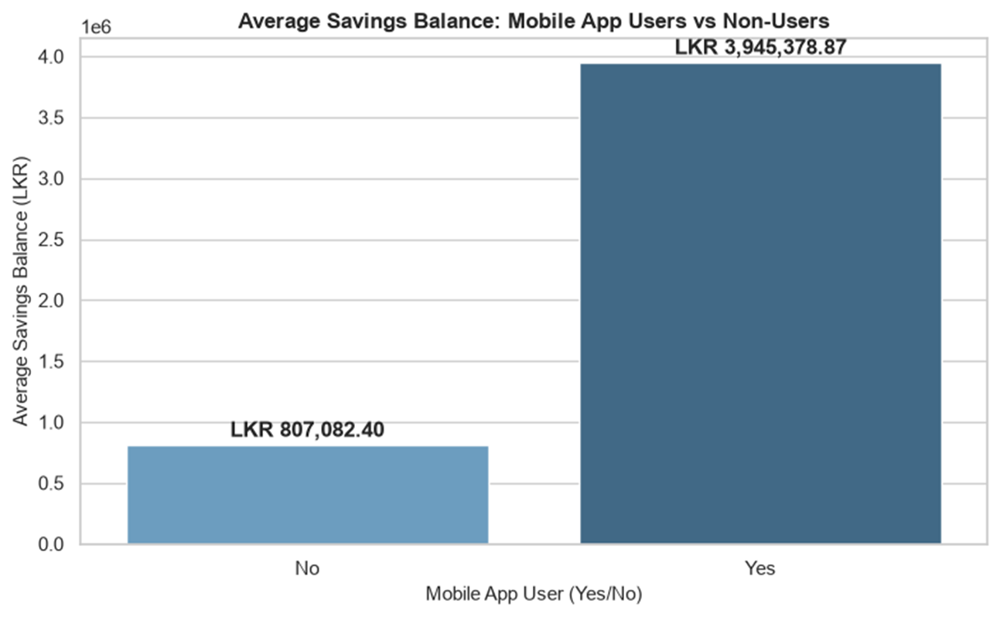
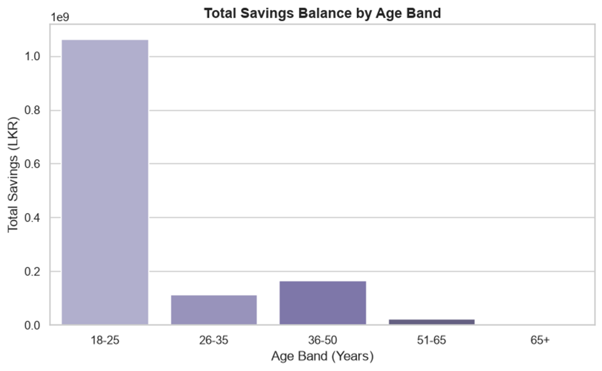
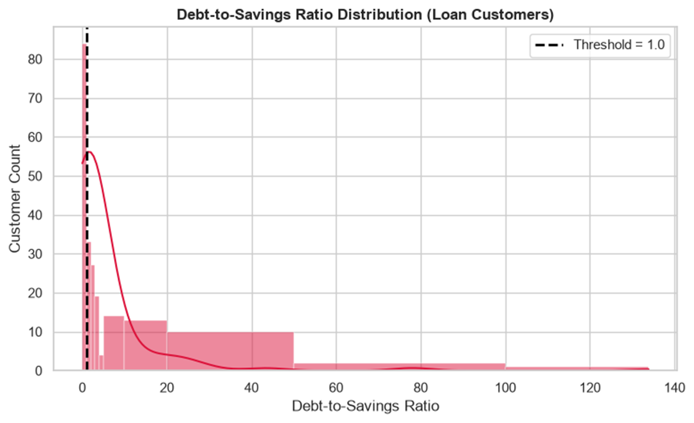
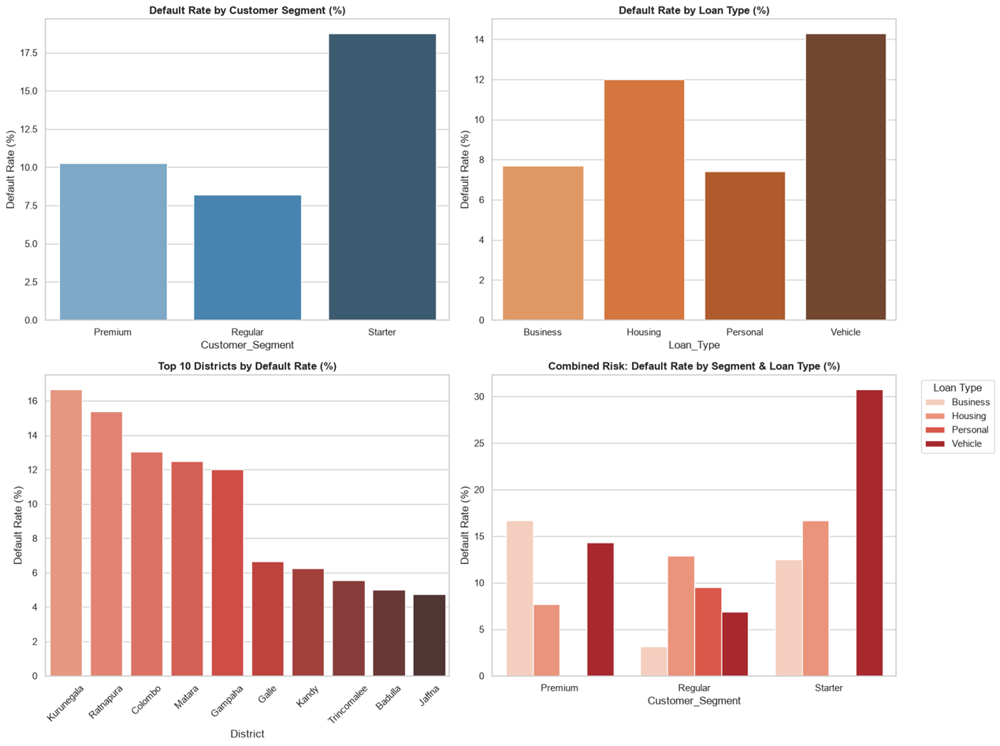
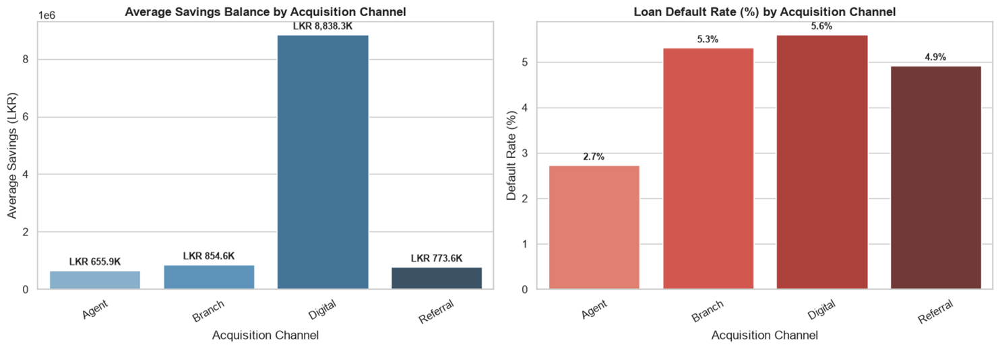
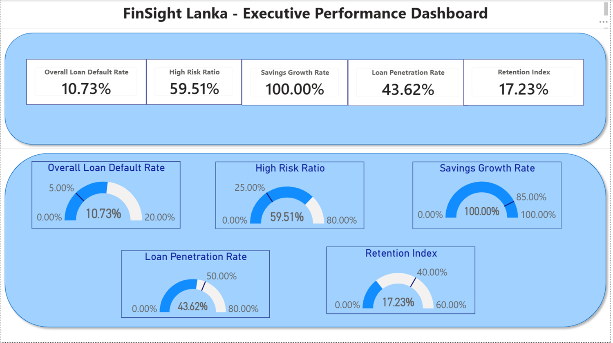

# 🚀  FinSight Lanka - Data Analytics Assessment

[](https://github.com/LahiruButhsara34/Lahiru_Wijesekara_FinSightAssessment_Workings)

🔗 **Repository Link:** [https://github.com/LahiruButhsara34/ETH-SOL-Price-Predictor](https://github.com/LahiruButhsara34/Lahiru_Wijesekara_FinSightAssessment_Workings)


This repository contains the complete end-to-end data analytics assessment for **Dialog Finance PLC (FinSight Lanka)**. The project evaluates customer credit risk, acquisition channel performance, debt-to-savings exposures, and strategic business growth opportunities.

---

## 📸 Presentation Screenshots

### 1. Savings Balance Comparison: Mobile App Users vs Non-Users



### 2. Savings Distribution by Age Band



### 3. Debt-to-Savings Ratio Analysis



### 4. loan default rates across Segment, District, or Loan Type



### 5. Savings Balance Comparison: Mobile App Users vs Non-Users


### 6. Acquisition Channel Performance Summary 



### 7. Executive Performance Dashboard



---

## 📌 Executive Summary

The primary objective of this project is to analyze loan application behavior, portfolio repayment trends, and channel efficiency to provide actionable insights for minimizing default risk while maximizing customer lifetime value (LTV).

### Key Analytical Focus Areas:
* **Data Cleaning & Preprocessing:** Handling missing values, feature engineering, and outlier detection.
* **Credit Risk Assessment:** Evaluating **Debt-to-Savings Ratio** and income-to-loan dynamics across default groups.
* **Channel Performance Evaluation:** Comparative analysis of Direct, Web, Partner, and Referral acquisition channels.
* **Strategic Recommendations:** Portfolio risk mitigation strategies tailored for Dialog Finance's retail lending ecosystem.

---

## 🛠️ Tech Stack & Tools Used

* **Language:** Python 3.10+
* **Data Processing & EDA:** Pandas, NumPy
* **Data Visualization:** Matplotlib, Seaborn
* **Business Intelligence:** Power BI (Executive KPI Dashboard)
* **Presentation:** Microsoft PowerPoint


---

## 📂 Project Structure & Deliverables

```text
Lahiru_Wijesekara_FinSightAssessment_Workings/
│
├── dashboards/
│   ├── Lahiru_Wijesekara_FinSightAssessment_Dashboard.pbix
│   └── Lahiru_Wijesekara_FinSightAssessment_Dashboard.pdf
│
├── data/
│   ├── 20260512_FintechTrainee_CaseStudy_Dataset_FinSightLanka_F.csv
│   ├── 20260512_FintechTrainee_CaseStudy_Dataset_FinSightLanka_F.xlsx
│   └── Cleaned_FinSightLanka_Data.csv
│
├── images/                  # Presentation and visualization figures
│
├── notebooks/               
│   ├── venv/                # Virtual Environment
│   ├── .gitignore
│   ├── 1.FinSight_Lanka_Data_Cleaning.ipynb
│   ├── 2.FinSight_Lanka_Data_Analysis.ipynb
│   └── requirements.txt     # Environment dependencies
│
├── 20260512_FintechTrainee_CaseStudy_Instructions_FinSightLanka_F.pdf
├── Lahiru_Wijesekara_FinSightAssessment_Presentation.pptx
└── README.md
